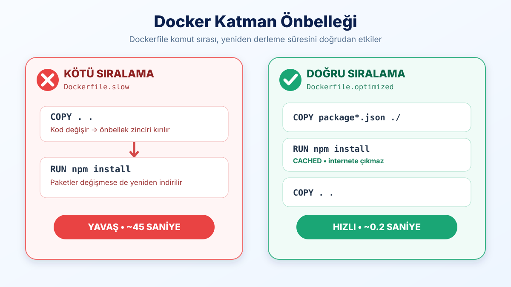
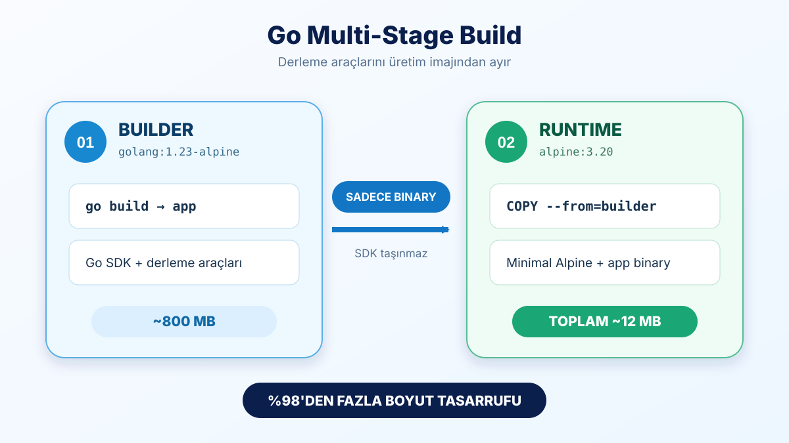

# * LAB-04: Dockerfile Optimizasyonu: Katman Önbellekleme (Layer Caching) ve Multi-Stage Build

## 🎯 Labın Amacı
Docker imaj derleme sürecini hızlandırmak ve nihai imaj boyutunu küçültmek;
1. **Katman Önbellekleme (Layer Caching):** Doğru `COPY` ve `RUN` sıralaması ile derleme süresini dakikalardan saniyelere indirmek.
2. **.dockerignore:** Gereksiz dosyaların (`node_modules`, `.git`) derleme bağlamına (build context) girmesini engellemek.
3. **Multi-Stage Build:** Derleyici ve SDK'ları nihai imajdan ayırarak Go imaj boyutunu **~850 MB'tan ~12 MB'a (%98)** düşürmek.

## 📋 Ön Koşullar & Portlar
- Docker Engine çalışır durumda olmalıdır.
- Host üzerinde **8080** portu boşta olmalıdır.

---

## 🚀 1. BÖLÜM: Katman Önbellekleme (Layer Caching) ve .dockerignore

### 💡 Zihinsel Model: Docker Katmanları Nasıl Önbellekler?
Docker imajları bir Dockerfile'ı yukarıdan aşağıya satır satır derler:
- Eğer bir satırda ve kopyalanan dosyalarda **hiçbir değişiklik yoksa**, Docker o adımı çalıştırmaz; önbellekten alır (`---> CACHED`).
- Ancak bir satırda değişiklik olursa, **o satır ve altındaki TÜM adımlar geçersiz kalır (Cache Invalidation / Cache Bust)** ve sıfırdan çalıştırılır.



---

### Adım 1: Caching Dizinine Geçin
```bash
# Lab caching dizinine geçin:
cd ~/docker-labs/lab-04-layer-caching-and-multistage/caching
```

### Adım 2: Kötü Sıralı İmajı İlk Kez Derleyin
Tüm dosyaların tek seferde kopyalandığı `Dockerfile.slow` dosyasını derleyin:
```bash
docker build -f Dockerfile.slow -t cache-demo:slow-v1 .
```
*(İlk derlemede tüm npm paketleri internetten indirilir).*

### Adım 3: Kaynak Kodda Küçük Bir Değişiklik Yapın
Uygulama kodunun sonuna zararsız bir yorum satırı ekleyin:
```bash
echo '// Yeni versiyon guncellemesi' >> server.js
```

### Adım 4: Kötü Sıralı İmajı Tekrar Derleyin (Yavaşlığı Görün!)
```bash
docker build -f Dockerfile.slow -t cache-demo:slow-v2 .
```
*(Gözlem: Paketler hiç değişmediği halde `RUN npm install` adımı sıfırdan tekrar çalıştı ve bekletti! Çünkü `COPY . .` satırı kaynak kod değişiminden dolayı önbelleği patlattı).*

---

### Adım 5: Doğru Sıralı (Optimize) İmajı İlk Kez Derleyin
Paket tanımlarının (`package*.json`) kodlardan önce kopyalandığı `Dockerfile.optimized` dosyasını derleyin:
```bash
docker build -f Dockerfile.optimized -t cache-demo:opt-v1 .
```

### Adım 6: Kaynak Kodda Tekrar Küçük Bir Değişiklik Yapın
```bash
echo '// Baska bir ozellik eklendi' >> server.js
```

### Adım 7: Doğru Sıralı İmajı Tekrar Derleyin (Önbellekleme Hızını Gözlemleyin)
```bash
docker build -f Dockerfile.optimized -t cache-demo:opt-v2 .
```
*(Gözlem: Terminal çıktısında `RUN npm install` adımının yanında `CACHED` yazar! Docker paketleri tekrar indirmez, derleme yarım saniyede biter).*

---

### Adım 8: .dockerignore Dosyasını İnceleyin
Ana makinedeki devasa `node_modules`, `.git` klasörlerinin derleme sırasında Docker Daemon'a gönderilmesini engelleyin:
```bash
cat .dockerignore
```

---

## 🚀 2. BÖLÜM: Çok Aşamalı İmaj Derleme (Multi-Stage Build)

### 💡 Zihinsel Model: Neden Derleyiciyi Taşımayalım? (Derlenen vs Yorumlanan Diller)
- **Yorumlanan Diller (Node.js, Python, PHP):** Çalışmak için çalışma zamanına (`runtime`) ve harici kütüphane klasörüne (`node_modules`) bağımlıdır.
- **Derlenen Diller (Go, Rust, C):** Kodu derlemek için ağır bir SDK gerekir (Go SDK ~800 MB). Ancak derleme bittiğinde geriye tüm kütüphaneleri içine gömmüş **tek bir statik ikili dosya (binary)** kalır!
- **Multi-Stage Build Mantığı:** İlk aşamada (`AS builder`) devasa SDK içinde derleme yapılır; ikinci aşamada (`FROM alpine` veya `FROM scratch`) sadece üretilen küçücük binary taşınır ve 800 MB'lık derleyici çöpe atılır.



---

### Adım 9: Go Uygulama Dizinine Geçin
```bash
# Go uygulama dizinine geçin:
cd ~/docker-labs/lab-04-layer-caching-and-multistage/go-app
```

### Adım 10: Tek Aşamalı (Single-Stage) Ağır İmajı Derleyin
Derleyicinin imaj içinde kaldığı geleneksel yöntemle derleyin:
```bash
docker build -f Dockerfile.single-stage -t go-app:heavy .
```

### Adım 11: Çok Aşamalı (Multi-Stage) Minimal İmajı Derleyin
Builder ve Runtime aşamalarının ayrıldığı optimize yöntemle derleyin:
```bash
docker build -f Dockerfile.multi-stage -t go-app:light .
```

### Adım 12: Boyut Farkını Karşılaştırın (Büyük Fark!)
```bash
docker images | grep -E "go-app"
```
*Gözlem:*
- `go-app:heavy`: Yaklaşık **850 MB**
- `go-app:light`: Sadece **~12 MB**! *(%98'den fazla disk ve network tasarrufu).*

---

### Adım 13: Minimal İmajı Çalıştırın ve Test Edin
Konteyner içinde Go SDK olmadığı halde derlenmiş binary'nin kusursuz çalıştığını teyit edin:
```bash
# 1. Konteyneri başlatın:
docker run -d --name go-service -p 8080:8080 go-app:light

# 2. HTTP isteği ile doğrulayın:
curl http://localhost:8080
```

---

## ✅ Doğrulama (Verification)
- Optimize Docker build çıktısında `RUN npm install` adımının `CACHED` olarak atlandığını gördünüz.
- `docker images` listesinde `go-app:light` imajının 15 MB altında olduğunu teyit ettiniz.
- `curl http://localhost:8080` çıktısında `Multi-Stage Build Basariyla Calisiyor!` yanıtını aldınız.

---

## 🧹 Temizlik
```bash
# Çalışan konteyneri durdurup silin:
docker rm -f go-service 2>/dev/null || true

# Test için oluşturulan imajları temizleyin:
docker rmi go-app:heavy go-app:light cache-demo:slow-v1 cache-demo:slow-v2 cache-demo:opt-v1 cache-demo:opt-v2 2>/dev/null || true

# server.js üzerindeki eklenen yorum satırlarını geri alın:
cd ../caching && git checkout -- server.js 2>/dev/null || true
```
