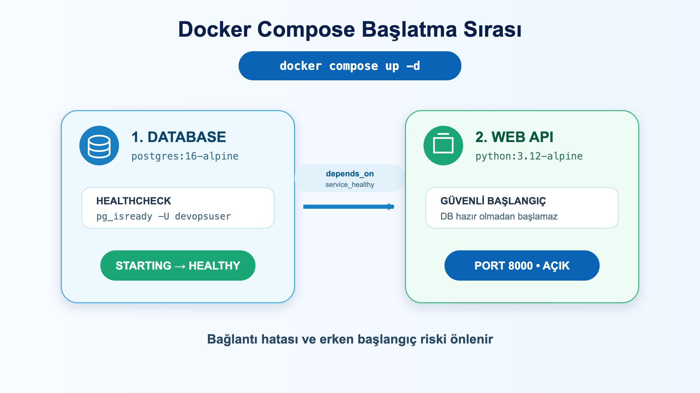

# LAB-DOC-07-01 — Docker Compose V2 Temelleri, .env Yönetimi ve Healthcheck Zinciri

| Seviye | Profil / Araçlar | Açık Portlar |
| --- | --- | --- |
| Orta | `docker-compose`, `postgres:16-alpine`, `curl` | 8000 |

---

## Amaç

- Birden fazla servisten oluşan mikroservis mimarilerini tek bir bildirimsel (`docker-compose.yaml`) dosya ile orkestre etmek.
- Hassas bilgileri ve port tanımlarını 12-Factor App prensibine uygun olarak `.env` dosyasından dinamik beslemek.
- `depends_on: condition: service_healthy` mekanizması ile veritabanı sorgu kabul edecek duruma gelmeden API servisinin başlamasını önlemek (CrashLoop engelleme).

---

## Ön Koşullar

- Docker Engine 24+ ve Docker Compose V2 (`docker compose version`).
- Host üzerinde `8000` portu boşta olmalıdır.

---

## Mimari ve Çalışma Modeli



---

## Adım Adım Uygulama Rehberi

### 1. Yapılandırmayı ve .env Değişkenlerini Doğrulama
```bash
# YAML sözdizimini ve .env değişkenlerinin yerleşimini kontrol edin:
docker compose config
```

### 2. Stack'i Arka Planda Başlatma
```bash
# Tüm servisleri, ağları ve volume'ları tek komutla ayağa kaldırın:
docker compose up -d
```

### 3. Servis Durumlarını ve Sağlık Kontrolünü İzleme
```bash
# Veritabanının healthy duruma geçmesini ve API servisinin başladığını gözlemleyin:
docker compose ps
```

### 4. HTTP API Uç Noktasını Test Etme
```bash
# API servisinin 8000 portu üzerinden çalıştığını doğrulayın:
curl -i http://localhost:8000
```

---

## Doğal Doğrulama ve Beklenen Sonuç

```bash
docker compose ps
```

Beklenen çıktı:
```text
NAME          IMAGE                COMMAND                  SERVICE    STATUS
compose-api   python:3.12-alpine   "sh -c 'echo 'API ba…"   web-api    Up (running)
compose-db    postgres:16-alpine   "docker-entrypoint.s…"   database   Up (healthy)
```

---

## Temizlik

```bash
# Konteynerları, ağı ve veritabanı volume'unu tamamen temizleyin:
docker compose down -v
```
