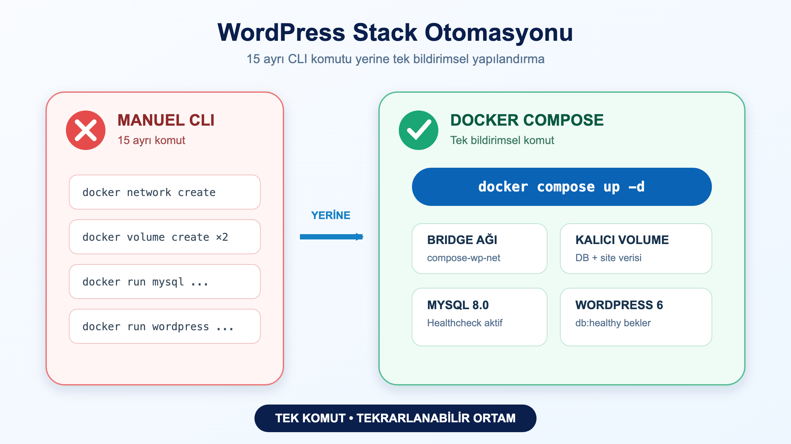

# LAB-DOC-07-02 — WordPress + MySQL Stack'inin Docker Compose ile Otomasyonu

| Seviye | Profil / Araçlar | Açık Portlar |
| --- | --- | --- |
| Orta | `docker compose`, `mysql:8.0`, `wordpress:6-apache` | 8080 |

---

## Amaç

Saf Docker CLI komutlarıyla (network oluşturma, volume oluşturma, uzun `docker run` bayrakları yazma) kurulan WordPress ve MySQL mimarisini, tek bir bildirimsel `docker-compose.yaml` ve `.env` dosyası ile otomatik ayağa kaldırmak ve yönetmektir:

- Çok sayıda manuel komut yerine tek komutla (`docker compose up -d`) tüm ortamı ayağa kaldırmak.
- Hassas şifreleri ve ortam değişkenlerini `.env` dosyası üzerinden izole etmek.
- MySQL servisi için `mysqladmin ping` tabanlı sağlık kontrolü tanımlamak.
- WordPress'in MySQL `healthy` olmadan başlamasını engelleyen `depends_on: condition: service_healthy` mekanizmasını uygulamak.

---

## Ön Koşullar

- Docker Engine 24+ ve Docker Compose V2 (`docker compose version`).
- Host üzerinde `8080` portunun boşta olması.
- `.env` ve `docker-compose.yaml` dosyalarının bulunduğu dizinde olmak.

---

## Mimari ve Çalışma Modeli



---

## Adım Adım Uygulama Rehberi

### 1. Yapılandırma ve Değişkenleri İnceleme

`.env` dosyasındaki şifre ve konfigürasyon parametrelerini doğrulayın:

```bash
cat .env
docker compose config
```

### 2. Stack'i Arka Planda Başlatma

Tüm servisleri, ağları ve Named Volume'ları tek komutla oluşturup başlatın:

```bash
docker compose up -d
```

### 3. Servislerin Sağlık Durumunu İzleme

MySQL'in `healthy` duruma geçmesini ve WordPress servisinin aktifleşmesini gözlemleyin:

```bash
docker compose ps
```

### 4. Servis Loglarını Görüntüleme

WordPress ve MySQL servislerinin başlangıç loglarını inceleyin:

```bash
docker compose logs --tail=20 wordpress
docker compose logs --tail=20 db
```

---

## Doğal Doğrulama ve Beklenen Sonuç

### 1. Konteyner Durumlarını Doğrulama

```bash
docker compose ps
```

Beklenen çıktı:
```text
NAME             IMAGE                COMMAND                  SERVICE     STATUS
compose-wp-app   wordpress:6-apache   "docker-entrypoint.s…"   wordpress   Up (running)
compose-wp-db    mysql:8.0            "docker-entrypoint.s…"   db          Up (healthy)
```

### 2. WordPress Kurulum Ekranını Test Etme

```bash
curl -I http://localhost:8080/wp-admin/install.php
```

Beklenen HTTP yanıtı:
```text
HTTP/1.1 200 OK
```

HTML çıktısında WordPress kurulum başlığını doğrulayın:

```bash
curl -s http://localhost:8080/wp-admin/install.php | grep -i "WordPress"
```

---

## Temizlik

Test tamamlandıktan sonra tüm konteynerları, ağı ve kalıcı veritabanı volume'larını temizleyin:

```bash
docker compose down -v
```
