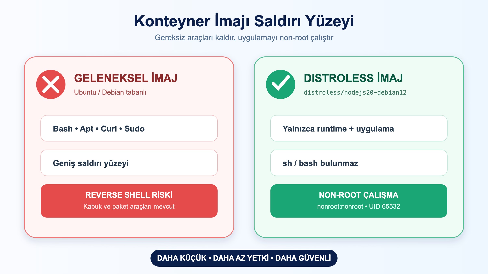

# LAB-DOC-09-01 — Google Distroless İmajlar ve Non-Root Kullanıcı Güvenliği

| Seviye | Profil / Araçlar | Açık Portlar |
| --- | --- | --- |
| İleri | `distroless`, `docker-ce`, `node` | 8080 |

---

## Amaç

- Konteynerların varsayılan `root (UID 0)` yerine kısıtlı kullanıcı (`UID 10001`) ile çalışmasını zorunlu kılmak.
- İçinde hiçbir shell (`bash`, `sh`) veya paket yöneticisi (`apt`, `apk`) bulunmayan **Google Distroless** taban imajlarını kullanmak.
- Konteyner içine saldırgan sızsa bile komut çalıştırmasını imkansız hale getirerek saldırı yüzeyini sıfırlamak.

---

## Ön Koşullar

- LAB-DOC-08 tamamlanmış olmalıdır.
- Host üzerinde `8080` portu boşta olmalıdır.

---

## Mimari ve Shell-less Güvenlik Modeli



---

## Adım Adım Uygulama Rehberi

### 1. Basit Bir Node.js Uygulaması Hazırlama
```bash
mkdir -p /tmp/distroless-demo && cd /tmp/distroless-demo

cat <<'EOF' > server.js
const http = require('http');
const server = http.createServer((req, res) => {
  res.writeHead(200, {'Content-Type': 'application/json'});
  res.end(JSON.stringify({ 
    status: "Distroless Aktif", 
    uid: process.getuid ? process.getuid() : "N/A" 
  }));
});
server.listen(8080, () => console.log('Distroless sunucu port 8080'));
EOF
```

### 2. Distroless Dockerfile Yazımı
```bash
cat <<'EOF' > Dockerfile
# 1. Aşama: Bağımlılıkları ve kodları hazırlayan builder
FROM node:20-alpine AS builder
WORKDIR /app
COPY server.js .

# 2. Aşama: Google Distroless çalışma ortamı
FROM gcr.io/distroless/nodejs20-debian12:nonroot
WORKDIR /app
COPY --from=builder /app/server.js .

# Distroless yerleşik nonroot kullanıcısını kullanır
USER nonroot

EXPOSE 8080
CMD ["server.js"]
EOF
```

### 3. İmajı Derleme ve Konteynerı Başlatma
```bash
docker build -t app-distroless:1.0 .
docker run -d --name distroless-web -p 8080:8080 app-distroless:1.0

# Servisi test edin:
curl http://localhost:8080
```

### 4. Saldırı Yüzeyini Doğrulama (Shell Açılamaması)
```bash
# Konteyner içine sh veya bash ile bağlanmayı deneyin:
docker exec -it distroless-web sh 2>&1 || true
# HATA: OCI runtime exec failed: exec: "sh": executable file not found in $PATH
```

---

## Doğal Doğrulama ve Beklenen Sonuç

```bash
docker exec distroless-web sh 2>&1 | grep -i "not found"
# Çıktıda 'executable file not found' hatası görülerek shell'in olmadığı kanıtlanmalıdır.
```

---

## Temizlik

```bash
docker rm -f distroless-web 2>/dev/null || true
docker rmi app-distroless:1.0 2>/dev/null || true
rm -rf /tmp/distroless-demo
```
