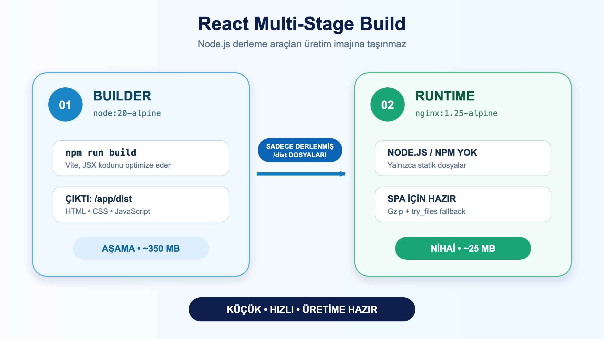

# LAB-DOC-03-07 — Frontend (React SPA + Vite) Uygulamasını Multi-Stage ve Nginx ile Dockerize Etme

| Seviye | Profil / Araçlar | Açık Portlar |
| --- | --- | --- |
| Orta | `node:20-alpine`, `nginx:1.25-alpine`, `curl` | 19001 (App Slot 1) |

> **Önemli Erişim Notu:** Sunucuda Port 80 Nginx Master Reverse Proxy tarafından kullanıldığından, React SPA konteyneri platformdaki **19001** portuna eşlenir. Tarayıcınızdan `http://<SUNUCU-IP>:19001` veya `https://studentXX-app1.<domain>` üzerinden erişebilirsiniz.

---

## 1. Uygulama Hakkında

Modern web geliştirmede React, Vue veya Angular gibi Tek Sayfa Uygulamaları (Single Page Application - SPA) derlendikten sonra sadece statik HTML, CSS ve JavaScript dosyalarından ibarettir.

**En Büyük Hata:** Üretim ortamında React uygulamasını `node:20` imajı içinde `npm run dev` veya `npm start` ile ayağa kaldırmaktır. Bu durum:
* 400+ MB'lık devasa `node_modules` ve derleyicilerin bellekte gereksiz çalışmasına yol açar.
* Güvenlik açığı yaratır ve yavaş yanıt verir.

**Doğru Çözüm:** **Multi-Stage Build** ile 1. aşamada Node.js içinde `npm run build` çalıştırmak, üretilen `dist/` klasörünü alıp 2. aşamada ultra hafif (~25 MB) ve yüksek performanslı **Nginx** web sunucusu ile servis etmektir.

---

## 2. Klasik Linux (Ubuntu) Üzerinde Manuel Kurulum ve Çalıştırma

Dockerfile direktiflerini kurgulamak için referans Linux akışı:

```bash
# 1. Derleme makinesinde Node.js ile statik dosyaların üretilmesi
sudo apt update && sudo apt install -y nodejs npm
cd /app
npm ci
npm run build  # Çıktı: /app/dist klasörü

# 2. Üretim sunucusunda Nginx kurulması (Node.js ARTIK GEREKMEZ!)
sudo apt install -y nginx

# 3. Derlenmiş statik dosyaların Nginx web kök dizinine taşınması
sudo cp -r /app/dist/* /var/www/html/

# 4. Nginx SPA yönlendirme ayarı (try_files $uri /index.html;)
sudo cp nginx.conf /etc/nginx/conf.d/default.conf
sudo systemctl restart nginx
```

---

## 3. Zihinsel Eşleştirme Rehberi (Linux ➔ Multi-Stage Dockerfile)

| Klasik Linux Adımı | Karşılık Gelen Dockerfile Direktifi | Kritik En İyi Pratik (Best Practice) |
|:---|:---|:---|
| Node.js & npm | `FROM node:20-alpine AS builder` | 1. Aşama: Sadece statik JS/CSS üretimi için |
| `npm ci` | `COPY package*.json ./ && RUN npm ci` | Bağımlılık katmanı önbelleğe alınır |
| `npm run build` | `RUN npm run build` | `/app/dist` klasörüne statik HTML/JS çıkarılır |
| Nginx Web Sunucusu | `FROM nginx:1.25-alpine` | 2. Aşama: Node.js yok, yalnızca 25 MB'lık Nginx |
| Statik Dosyaları Aktarma | `COPY --from=builder /app/dist /usr/share/nginx/html` | Node.js ve node_modules çöpleri geride kalır |
| Nginx Ayarını Kopyalama | `COPY nginx.conf /etc/nginx/conf.d/default.conf` | SPA 404 önleyici `try_files` kuralı |
| Başlatma | `CMD ["nginx", "-g", "daemon off;"]` | Nginx'in ön planda çalışmasını sağlama |

---

## 4. SPA Mimarisi ve Nginx `try_files` Kuralı



---

## 5. Görevler (Tasks)

1. `package.json`, `src/App.jsx` ve `nginx.conf` dosyalarını inceleyin.
2. 2 aşamalı bir `Dockerfile` yazın:
   * **1. Aşama:** `node:20-alpine AS builder` (Build)
   * **2. Aşama:** `nginx:1.25-alpine` (Runtime)
3. İmajı `react-frontend-spa:v1.0` adıyla derleyin.
4. İmaj boyutunun **30 MB altında** olduğunu `docker images` ile doğrulayın.
5. Konteyneri başlatıp `http://localhost:80` üzerinden HTML başlığını doğrulayın.

---

## 6. İpuçları

<details>
<summary>💡 İpucu 1: try_files Neden Zorunludur?</summary>

React Router gibi istemci taraflı kütüphanelerde kullanıcı sayfayı yenilediğinde (örneğin `http://localhost/users/profile`), Nginx diskte `/users/profile` adında fiziksel bir dosya arar ve bulamayıp **404 Not Found** döner. `try_files $uri $uri/ /index.html;` kuralı sayesinde Nginx, fiziksel dosya yoksa isteği `index.html`'e devreder ve sayfa 404 vermeden sorunsuz açılır.
</details>

<details>
<summary>💡 İpucu 2: daemon off; Kuralı</summary>

Nginx varsayılan olarak bir arka plan arka plan süreci (daemon) gibi başlar. Konteyner ortamında ana süreç sonlandığında konteyner duracağı için Nginx `daemon off;` direktifi ile ön planda (foreground) çalışmaya zorlanır.
</details>

---

## 7. Referans Çözüm

<details>
<summary>🎯 Referans Multi-Stage Dockerfile</summary>

**`Dockerfile`:**
```dockerfile
# ==========================================
# 1. AŞAMA: DERLEYİCİ (BUILDER)
# ==========================================
FROM node:20-alpine AS builder

WORKDIR /app

# Bağımlılıkları önbelleğe alma
COPY package*.json ./
RUN npm ci

# Kaynak kodları kopyalayıp derleme
COPY . .
RUN npm run build

# ==========================================
# 2. AŞAMA: ÇALIŞMA ZAMANI (RUNTIME - NGINX)
# ==========================================
FROM nginx:1.25-alpine

# Varsayılan Nginx karşılama dosyalarını temizleme
RUN rm -rf /usr/share/nginx/html/*

# Özel SPA yönlendirmeli Nginx konfigürasyonunu kopyalama
COPY nginx.conf /etc/nginx/conf.d/default.conf

# Builder aşamasından sadece derlenen statik dosyaları aktarma
COPY --from=builder /app/dist /usr/share/nginx/html

EXPOSE 80

# Nginx'i ön planda çalıştırma
CMD ["nginx", "-g", "daemon off;"]
```

**Derleme ve Çalıştırma:**
```bash
# 1. İmajı derleme
docker build -t react-frontend-spa:v1.0 .

# 2. Boyut kontrolü (yaklaşık 25 MB olmalıdır)
docker images react-frontend-spa:v1.0

# 3. Konteyneri başlatma
docker run -d --name my-react-spa -p 19001:80 react-frontend-spa:v1.0

# 4. Yanıtı test etme
curl -i http://localhost:19001
```
</details>

---

## 8. Doğrulama ve Beklenen Sonuç

```bash
curl -s http://localhost:19001 | grep "React SPA + Nginx"
```

* **HTML Yanıtı:** `<title>DevOps React SPA</title>`
* **İmaj Boyut Başarısı:** `docker images react-frontend-spa:v1.0` çıktısında `SIZE` sütunu **~25 MB** olmalıdır.
